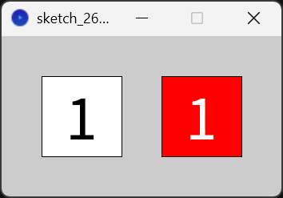
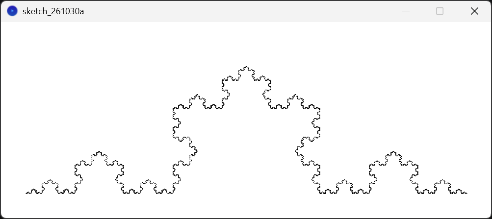

# 関数について
プログラミングにおいて関数とは、複数の処理を一つにまとめる機能のことである。
関数によっては値を返却することもある。

## まずは練習
まず最初に、普段は白地に黒だがマウスを左クリックしてから3秒の間、赤地に白になるような、正方形の中央に適当な数字を描画するプログラムを作ってみよう。(サイズは自由)

イメージ図(実際は一個だけ)  


<details>
<summary>
記述例
</summary>

```processing
final int RECT_COLOR=color(255);
final int PRESSED_RECT_COLOR=color(255,0,0);
final int TEXT_COLOR=color(0);
final int PRESSED_TEXT_COLOR=color(255);

int pressed_time;

void setup(){
  size(200,200);
  pressed_time=0;
}

void draw(){
  boolean change_color=false;
  if(pressed_time!=0&&millis()-pressed_time<3000){
    change_color=true;
  }
  if(change_color){
    fill(PRESSED_RECT_COLOR);
  }else{
    fill(RECT_COLOR);
  }
  rect(50,50,100,100);
  textAlign(CENTER,CENTER);
  textSize(80);
  if(change_color){
    fill(PRESSED_TEXT_COLOR);
  }else{
    fill(TEXT_COLOR);
  }
  text(3,100,100);
}

void mousePressed(){
  if(mouseButton==LEFT){
    pressed_time=millis();
  }
}
```

</details>

では次に、既に描画されている物に追加してマウスを押してから4秒の間、5秒の間、6秒の間色が変化するものを描画してみよう。(描画するものは3秒の時と同じ)

<details>
<summary>
記述例(増量)
</summary>

```processing
final int RECT_COLOR=color(255);
final int PRESSED_RECT_COLOR=color(255,0,0);
final int TEXT_COLOR=color(0);
final int PRESSED_TEXT_COLOR=color(255);

int pressed_time;

void setup(){
  size(350,350);
  pressed_time=0;
}

void draw(){
  boolean change_color;
  // 3秒
  change_color=false;
  if(pressed_time!=0&&millis()-pressed_time<3000){
    change_color=true;
  }
  if(change_color){
    fill(PRESSED_RECT_COLOR);
  }else{
    fill(RECT_COLOR);
  }
  rect(50,50,100,100);
  textAlign(CENTER,CENTER);
  textSize(80);
  if(change_color){
    fill(PRESSED_TEXT_COLOR);
  }else{
    fill(TEXT_COLOR);
  }
  text(3,100,100);
  // 4秒
  change_color=false;
  if(pressed_time!=0&&millis()-pressed_time<4000){
    change_color=true;
  }
  if(change_color){
    fill(PRESSED_RECT_COLOR);
  }else{
    fill(RECT_COLOR);
  }
  rect(200,50,100,100);
  textAlign(CENTER,CENTER);
  textSize(80);
  if(change_color){
    fill(PRESSED_TEXT_COLOR);
  }else{
    fill(TEXT_COLOR);
  }
  text(4,250,100);
  // 5秒
  change_color=false;
  if(pressed_time!=0&&millis()-pressed_time<5000){
    change_color=true;
  }
  if(change_color){
    fill(PRESSED_RECT_COLOR);
  }else{
    fill(RECT_COLOR);
  }
  rect(50,200,100,100);
  textAlign(CENTER,CENTER);
  textSize(80);
  if(change_color){
    fill(PRESSED_TEXT_COLOR);
  }else{
    fill(TEXT_COLOR);
  }
  text(5,100,250);
  // 6秒
  change_color=false;
  if(pressed_time!=0&&millis()-pressed_time<6000){
    change_color=true;
  }
  if(change_color){
    fill(PRESSED_RECT_COLOR);
  }else{
    fill(RECT_COLOR);
  }
  rect(200,200,100,100);
  textAlign(CENTER,CENTER);
  textSize(80);
  if(change_color){
    fill(PRESSED_TEXT_COLOR);
  }else{
    fill(TEXT_COLOR);
  }
  text(6,250,250);
}

void mousePressed(){
  if(mouseButton==LEFT){
    pressed_time=millis();
  }
}
```

</details>

どうですか?  
少しずつ時間が違うおかげで、コードの見た目と書いた量が大変なことになっていませんか?

では、中央の数字を色が変化する残り時間に合わせてみましょう!

<details>
<summary>
記述例(特盛)
</summary>

```processing
final int RECT_COLOR=color(255);
final int PRESSED_RECT_COLOR=color(255,0,0);
final int TEXT_COLOR=color(0);
final int PRESSED_TEXT_COLOR=color(255);

int pressed_time;

void setup(){
  size(350,350);
  pressed_time=0;
}

void draw(){
  boolean change_color;
  int change_timer;
  // 3秒
  change_color=false;
  change_timer=0;
  if(pressed_time!=0&&millis()-pressed_time<3000){
    change_color=true;
    change_timer=3-floor((millis()-pressed_time)/1000.f);
  }
  if(change_color){
    fill(PRESSED_RECT_COLOR);
  }else{
    fill(RECT_COLOR);
  }
  rect(50,50,100,100);
  textAlign(CENTER,CENTER);
  textSize(80);
  if(change_color){
    fill(PRESSED_TEXT_COLOR);
  }else{
    fill(TEXT_COLOR);
  }
  text(change_timer,100,100);
  // 4秒
  change_color=false;
  change_timer=0;
  if(pressed_time!=0&&millis()-pressed_time<4000){
    change_color=true;
    change_timer=4-floor((millis()-pressed_time)/1000.f);
  }
  if(change_color){
    fill(PRESSED_RECT_COLOR);
  }else{
    fill(RECT_COLOR);
  }
  rect(200,50,100,100);
  textAlign(CENTER,CENTER);
  textSize(80);
  if(change_color){
    fill(PRESSED_TEXT_COLOR);
  }else{
    fill(TEXT_COLOR);
  }
  text(change_timer,250,100);
  // 5秒
  change_color=false;
  change_timer=0;
  if(pressed_time!=0&&millis()-pressed_time<5000){
    change_color=true;
    change_timer=5-floor((millis()-pressed_time)/1000.f);
  }
  if(change_color){
    fill(PRESSED_RECT_COLOR);
  }else{
    fill(RECT_COLOR);
  }
  rect(50,200,100,100);
  textAlign(CENTER,CENTER);
  textSize(80);
  if(change_color){
    fill(PRESSED_TEXT_COLOR);
  }else{
    fill(TEXT_COLOR);
  }
  text(change_timer,100,250);
  // 6秒
  change_color=false;
  change_timer=0;
  if(pressed_time!=0&&millis()-pressed_time<6000){
    change_color=true;
    change_timer=6-floor((millis()-pressed_time)/1000.f);
  }
  if(change_color){
    fill(PRESSED_RECT_COLOR);
  }else{
    fill(RECT_COLOR);
  }
  rect(200,200,100,100);
  textAlign(CENTER,CENTER);
  textSize(80);
  if(change_color){
    fill(PRESSED_TEXT_COLOR);
  }else{
    fill(TEXT_COLOR);
  }
  text(change_timer,250,250);
}

void mousePressed(){
  if(mouseButton==LEFT){
    pressed_time=millis();
  }
}
```

</details>

......めんどうでしたよね?

## そもそもどうして関数を使うのか?
関数を使う理由として、ほとんど同じ動作をする処理を繰り返して書く必要がなくなるため、コードの記述量が大幅に減ることや、仕様を変更した際に、書き直す場所を減らすことができるという点が挙げられます。  
また、処理の種類ごとに別のタブに関数を記述しておくことで、目的の処理を行っている部分を見つけやすくすることができます。

関数の宣言をおさらいして、実際に描画する部分を関数にしてみましょう。

## 関数についてのおさらい
さて、ここからは関数についての復習に入ります。今までのプログラムは保存して、閉じておきましょう。

関数は、以下のように宣言することができます。
```processing
<返り値の型><関数名>([引数の型と名前]){
  <処理>
}
```
引数はカンマ区切りで複数個与えることができますが、宣言されている型と個数が一致している必要があります。

## 返り値のない関数
戻り値がない関数を宣言するときは、返り値の型に`void`を指定します。  

例として、キーを押している間だけ背景を赤色で塗りつぶす関数を示します。  
コピペしてdraw関数から呼び出してみましょう。

```processing
void backWithKey(){
  if(keyPressed){
    background(255,0,0);
  }
}
```

それでは試しに、プログラムが開始してからの経過時間(秒)を左上の角に表示する関数`drawTime()`を作ってみましょう。  
プログラム開始してからの経過時間(ミリ秒)の取得は`millis()`関数で行うことができます。

<details>
<summary>
作例
</summary>

```processing
void drawTime(){
  textAlign(LEFT,TOP);
  fill(0);
  text(millis()/1000.f,0,0);
}
```

</details>

では、これを引数をとるように変更してみましょう。  
rgb値を引数をとってテキストの色を設定できる`drawTime(int r,int g,int b)`に改造してください。

<details>
<summary>
作例
</summary>

```processing
void drawTime(int r,int g,int b){
  textAlign(LEFT,TOP);
  fill(r,g,b);
  text(millis()/1000.f,0,0);
}
```

</details>

## 関数のオーバーロード
processingやjava、c++などの一部言語ではオーバーロードと呼ばれる機能を利用することができます。  
オーバーロードとは、同じ名前の関数を複数個宣言することのできる仕組みで、引数の型か引数の数が違う必要があります。

引数が異なるだけで**宣言する際に追加の操作は必要ありません。**

先ほどの`drawTime(int r,int g,int b)`についてみてみましょう。  
色を変更する際は実際には白か黒なのでrgb値を使用する人は、あまりいないと思います。  
ですから、オーバーロードを利用して直接グレースケール値やアルファ値を指定できるようにしましょう。

オーバーロードを行う際は、一般的に引数の少ない関数から引数の多い関数を呼び出します。  
なぜなら、足りてない引数を初期値として渡すことができるからです。

次の関数をオーバーロードを利用して作ってみましょう。

注: c言語などを勉強した方へ  
processingでは関数は宣言した順番などは関係ないので仮宣言などを行う必要はありません。

* `drawTime(int r,int g,int b)`
* `drawTime(int r,int g,int b,int a)`
* `drawTime(int gray)`
* `drawTime(int gray,int a)`

<details>
<summary>
作例
</summary>

```processing
void drawTime(int r,int g,int b){
  drawTime(r,g,b,255);
}

void drawTime(int r,int g,int b,int a){// 実際に処理をしている関数はこれだけ!
  textAlign(LEFT,TOP);
  fill(r,g,b,a);
  text(millis()/1000.f,0,0);
}

void drawTime(int gray){
  drawTime(gray,255);
}

void drawTime(int gray,int a){
  drawTime(gray,gray,gray,a);
}
```

</details>

## 返り値のある関数
次に返り値のある関数についてみていきましょう。
返り値がある関数の場合、どのような場合でも必ず宣言した型として扱うことのできる値を`return`文で返さなければなりません。

たとえば、次のような関数はエラーになります。

```processing
// returnしていないためエラー
int sum(int a,int b){
  int ans=a+b;
}

// if文がelseの時に値がreturnされないためエラー
boolean isPlus(int n){
  if(n>0){
    return true;
  }
}

// intではなくfloatをreturnしようとしているのでエラー
int getRad(int x,int y){
  return atan2(y,x);
}
```

では、プログラムを開始してからの経過時間(秒)を`float`で返す`getTime()`を作成してください。

<details>
<summary>
作例
</summary>

```processing
float drawTime(){
  return millis()/1000.f;
}
```

</details>

## 可変長引数
さて、ここまで関数を見てきて決まった数しか引数をとれないことに気付いたと思われます。  
しかし、processingでは最後の引数に限り、いくつでも値を受け取ることのできる仕組みがあります。  
それが、可変長引数です。

以下は、受け取った値をすべて合計した値を返す関数の例です。  
可変長引数は型の後ろにピリオドを三つくっつけることで宣言でき、可変長引数として受け取った値は配列として扱われます。

```processing
int sum(int... n){
  int ans=0;
  for(int value:n){
    ans+=value;
  }
  return ans;
}
```

## 実際に先ほどの正方形部分の描画を関数にまとめてみよう
では、一番最初のプログラムで正方形を位置と時間を引数にとり、`(x,y)`に描画する関数`drawRect(float x,float y,int time)`を作ってみましょう。`time`は色が変化する時間を表しています。  
最初のプログラムの描画を担当する部分を抜き出して、必要なパラメータを引数に置き換えるだけでできます。ここまで来たあなたなら簡単なはずです。

<details>
<summary>
作例
</summary>

```processing
void drawRect(float x,float y,int time){
  boolean change_color=false;
  int change_timer=0;
  if(pressed_time!=0&&millis()-pressed_time<time*1000){
    change_color=true;
    change_timer=time-floor((millis()-pressed_time)/1000.f);
  }
  if(change_color){
    fill(PRESSED_RECT_COLOR);
  }else{
    fill(RECT_COLOR);
  }
  rect(x,y,100,100);
  textAlign(CENTER,CENTER);
  textSize(80);
  if(change_color){
    fill(PRESSED_TEXT_COLOR);
  }else{
    fill(TEXT_COLOR);
  }
  text(change_timer,x+50,y+50);
}
```

</details>

できましたか?  
では、実際にプログラムに組み込んでみましょう。

<details>
<summary>
記述例(減量)
</summary>

```processing
final int RECT_COLOR=color(255);
final int PRESSED_RECT_COLOR=color(255,0,0);
final int TEXT_COLOR=color(0);
final int PRESSED_TEXT_COLOR=color(255);

int pressed_time;

void setup(){
  size(350,350);
  pressed_time=0;
}

void draw(){
  // 3秒
  drawRect(50,50,3);
  // 4秒
  drawRect(200,50,4);
  // 5秒
  drawRect(50,200,5);
  // 6秒
  drawRect(200,200,6);
}

void mousePressed(){
  if(mouseButton==LEFT){
    pressed_time=millis();
  }
}

void drawRect(float x,float y,int time){
  boolean change_color=false;
  int change_timer=0;
  if(pressed_time!=0&&millis()-pressed_time<time*1000){
    change_color=true;
    change_timer=time-floor((millis()-pressed_time)/1000.f);
  }
  if(change_color){
    fill(PRESSED_RECT_COLOR);
  }else{
    fill(RECT_COLOR);
  }
  rect(x,y,100,100);
  textAlign(CENTER,CENTER);
  textSize(80);
  if(change_color){
    fill(PRESSED_TEXT_COLOR);
  }else{
    fill(TEXT_COLOR);
  }
  text(change_timer,x+50,y+50);
}
```

</details>

おめでとうございます!  
これで、あなたは関数マスターです!

## おまけ: 再帰関数 (時間が余ったらやる)
さて、関数の基本は先ほどまでで以上になります。  
ここからは、応用です。

関数は自分自身を呼び出すことができるので、無限ループを作ることができます。  
ふつうは無限ループを作るとプログラムがフリーズするので避けたいところですが、ループを中断することができる処理であれば、このループを利用することで処理を簡潔に書くことができる場合があります。  
この関数の呼び出し方を再帰呼び出しといいます。

例として、ハノイの塔の最小手数を求める関数を以下に示します。

```processing
int hanoi(int tower_height){
  if(height<=0){// 板がないなら移動の手数はゼロ
    return 0;
  }
  // 一個少ない塔を移動させる: hanoi(tower_height-1)
  // 一番下の板を移動させる: 1
  // 一番下の板の上に一個少ない塔を移動させる: hanoi(tower_height-1)
  // -> 2*hanoi(tower_height-1)+1
  return 2*hanoi(tower_height-1)+1;
}
```

また、自分自身を呼び出すという特徴から、再帰関数を扱うことでフラクタル図形を描画することもできます。

例. ドラゴン曲線の描画(矢印の上キーで再帰回数の増加、下キーで再帰回数の減少ができる)
```processing
void setup(){
  size(1000,800);
  count=0;
  noLoop();
  redraw();
}

int count=0;
final int MAX_COUNT=16;

void draw(){
  background(255);
  dragon(300,300,800,300,count);
}

void keyPressed(){
  if(keyCode==UP){
    count++;
    if(count>MAX_COUNT){
      count=MAX_COUNT;
    }else{
      redraw();
    }
  }
  if(keyCode==DOWN){
    count--;
    if(count<0){
      count=0;
    }else{
      redraw();
    }
  }
}

// 精度のためにdoubleを使用しています
void dragon(double x1,double y1,double x2,double y2,int num){
  if(num==0){//再起の残り回数が0の時
    line((float)x1,(float)y1,(float)x2,(float)y2);//ラインを引いて終了
    return;
  }
  double rad=Math.atan2(y2-y1,x2-x1);// 二点をつなぐ直線の角度
  double dist=Math.pow(Math.pow(x1-x2,2)+Math.pow(y1-y2,2),0.5)/Math.pow(2,0.5);// 新たに作成する一辺の長さ
  double x3=x1+dist*Math.cos(rad+Math.PI/4),
    y3=y1+dist*Math.sin(rad+Math.PI/4);//新たに作成される点の位置
  dragon(x1,y1,x3,y3,num-1);//再帰呼び出し
  dragon(x2,y2,x3,y3,num-1);//再帰呼び出し
}
```

それでは、次のコードの`koch`関数に追記する形でコッホ曲線を描画するプログラムを完成させてみましょう!

コッホ曲線  


```processing
void setup(){
  size(1000,400);
  count=0;
  noLoop();
  redraw();
}

int count=0;
final int MAX_COUNT=6;

void draw(){
  background(255);
  koch(50,350,950,350,count);
}

void keyPressed(){
  if(keyCode==UP){
    count++;
    if(count>MAX_COUNT){
      count=MAX_COUNT;
    }else{
      redraw();
    }
  }
  if(keyCode==DOWN){
    count--;
    if(count<0){
      count=0;
    }else{
      redraw();
    }
  }
}

// 精度のためにdoubleを使用しています
void koch(double x1,double y1,double x2,double y2,int num){
  // ここに追記
}
```

<details>
<summary>
実装例(関数部分のみ)
</summary>

```processing
//精度のためにdoubleを使用しています
void koch(double x1,double y1,double x2,double y2,int num){
  if(num==0){//再起の残り回数が0の時
    line((float)x1,(float)y1,(float)x2,(float)y2);//ラインを引いて終了
    return;
  }
  double rad=Math.atan2(y2-y1,x2-x1);// 二点をつなぐ直線の角度
  double dist=Math.pow(Math.pow(x1-x2,2)+Math.pow(y1-y2,2),0.5)/3;// 新たに作成する一辺の長さ
  double x3=x1+dist*Math.cos(rad),
    y3=y1+dist*Math.sin(rad),
    x4=x3+dist*Math.cos(rad-Math.PI/3),
    y4=y3+dist*Math.sin(rad-Math.PI/3),
    x5=x1+2*dist*Math.cos(rad),
    y5=y1+2*dist*Math.sin(rad);//新たに作成される点の位置
  koch(x1,y1,x3,y3,num-1);//再帰呼び出し
  koch(x3,y3,x4,y4,num-1);//再帰呼び出し
  koch(x4,y4,x5,y5,num-1);//再帰呼び出し
  koch(x5,y5,x2,y2,num-1);//再帰呼び出し
}
```

</details>

いかがでしたか?  
関数を使いたくなっていただければ幸いです。
